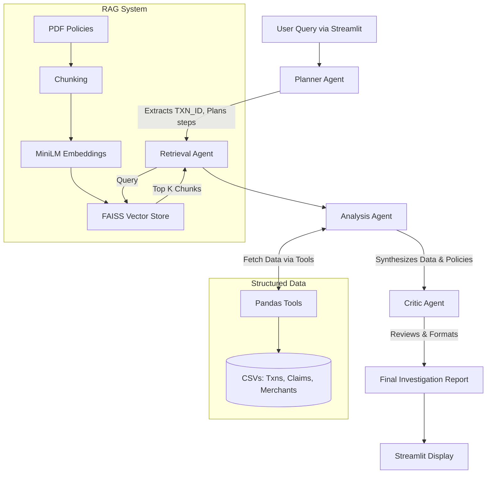

# Architecture: Agentic Financial Dispute Intelligence Engine

## System Overview

The system is designed as a Multi-Agent Retrieval-Augmented Generation (RAG) pipeline orchestrated using **LangGraph**. It combines structured database lookups (Pandas) with unstructured document retrieval (FAISS) to investigate financial disputes such as chargebacks and fraud claims.

## Key Components

### 1. Data Layer
*   **Structured Data (`data/structured/`)**: Synthetic CSVs containing `transactions`, `claims`, and `merchants`.
*   **Unstructured Data (`data/policies/`)**: PDF documents containing company policies on refunds, chargebacks, and fraud.

### 2. RAG Pipeline (`src/rag_pipeline.py`)
*   **Document Loader**: `PyPDFLoader` from LangChain Community.
*   **Text Splitter**: `RecursiveCharacterTextSplitter` (chunk size: 500, overlap: 50).
*   **Embeddings**: `sentence-transformers/all-MiniLM-L6-v2` (fast, local embedding model).
*   **Vector Store**: `FAISS` (Facebook AI Similarity Search) optimized for local CPU usage.

### 3. Agentic Workflow (`src/graph.py`)
Built with LangGraph to implement stateful multi-agent communication. The workflow is sequential:
1.  **Planner Node**: Decomposes the user query, extracts entities (Transaction ID, Claim ID), and outlines investigation steps.
2.  **Retrieval Node**: Uses the RAG pipeline to fetch top-K relevant policy chunks based on the query.
3.  **Analysis Node**: 
    *   Uses Python tools (`src/tools.py`) to query the structured CSV data.
    *   Combines structured data (transaction details, merchant risk) with unstructured data (retrieved policies).
    *   Generates an analysis draft.
4.  **Critic Node**: Reviews the analysis draft, checks for groundedness against retrieved evidence, assigns a confidence score, and formats the final Markdown report.

### 4. Language Model (LLM)
*   **Ollama**: Used to run models entirely locally without cloud dependencies.
*   **Model**: Llama 3 8B or Qwen 2.5 7B.

### 5. Frontend (`app.py`)
*   **Streamlit**: A multi-page UI allowing users to upload/view policies, ask investigation questions, and inspect the agent reasoning, retrieved evidence, and final report.

## Workflow Diagram

